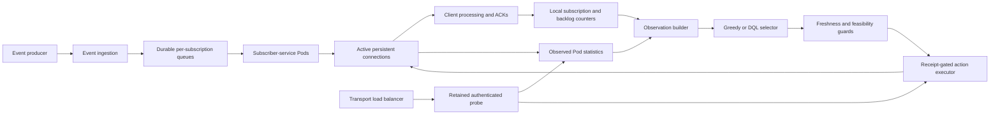

# Architecture and Control Flow

## Persistent Connections and Scaling

Each subscription has a durable logical queue. A client groups subscriptions
onto persistent connections; each connection reaches one subscriber-service
Pod. Adding ready Pods increases available service capacity, but an established
TCP connection remains on its original endpoint. Rebalancing makes that added
capacity accessible to subscriptions already bound to existing connections.



Arrows show data/control dependencies, not physical TCP direction. The probe
samples the endpoint assigned by the transport load balancer. The client does
not assume it can open a new socket directly to an arbitrary selected Pod.

## Observability

- A Pod reports its identity, total subscription count, cumulative backlog,
  and configured processing threshold.
- Active connections update the client-side cache; the probe adds a sampled
  candidate. A cached sample can be stale and must pass the freshness guard.
- The client observes its subscription queues, counts/backlog per connection,
  delivered/processed/ACK counters, and recent actions.
- The policy does not receive an omniscient cluster-wide variance.

For a client `u`, connection `c`, and subscription `k`, the connection backlog
is `G[u,c] = sum b[u,k]` over subscriptions assigned to `c`. Pod backlog `B[i]`
uses **all** queues served by Pod `i`, including other clients. The configured
Pod threshold is a normalization input, not a measured drain-time guarantee.
Effective throughput can also be limited by client processing and ACK capacity.

## Selector, Guard, Executor

The selector chooses a bounded template: stay, count rebalance, backlog
rebalance, connection scale-up, connection scale-down, or migrate to the probe.
DQL returns values for these templates; deterministic code resolves the
concrete source, target, and movable subscriptions.

The guard can reject a proposed action. Selection, application, and completed
execution are separate recorded events. A sampled probe is not automatically
promoted. A connection with no useful pressure improvement can be rejected
even if it reaches a different Pod.

The shared mechanism supports two selectors:

- **Guarded greedy:** uses measured pressure and explicit rules.
- **DQL:** uses the saved Q-network plus the same feasibility and execution
  checks. Training uses replay and a delayed target network; evaluation freezes
  weights and sets exploration to zero.

The paper does not evaluate a hybrid in which DQL secretly tunes the greedy
comparator. The strong greedy policy and the random scripted timing controls
are different baselines and must keep distinct names in analysis.

## Retained-Probe Handoff

```mermaid
sequenceDiagram
    participant C as Client/controller
    participant S as Source connection
    participant P as Retained probe/target
    C->>P: Authenticate and inspect Pod telemetry
    Note over C,P: Candidate may be rejected; no automatic promotion
    C->>C: Select action and pass deployment guards
    C->>P: Standby subscription association
    P-->>C: Readiness receipts for selected subscriptions
    C->>C: Promote retained probe into active connection set
    C->>S: Quiesce selected source subscriptions
    S-->>C: Quiesce receipts
    S-->>C: Fresh post-barrier state with zero in-flight delivery
    C->>P: Activate target subscriptions
    P-->>C: Activation receipts
    C->>S: Unsubscribe selected source bindings
    S-->>C: Detachment receipts
    C->>C: Retire source if appropriate and replenish probe
```

Durable subscription identifiers and queues remain the same. This is a change
of delivery association, not a copy of queued payloads. Unselected connections
remain active. The original socket is not retired merely because the target
TCP handshake succeeded.

Receipt accounting and zero-in-flight barriers concern client-observed
delivery state. They are not an exactly-once end-to-end identity proof. The
implementation described by the manuscript does not add a separate signed
promotion token, atomic cross-Pod ownership commit, or global FIFO contract.

## Why Compare TTL?

TTL reconnects connections based on age, regardless of their current pressure.
Connections created together can expire close together. During a loaded trial,
reconnects and renewed delivery can compete with subscription re-registration.
Selective migration instead changes one qualified connection at a time.

This is a mechanism comparison, not an assertion that all TTL deployments fail.
Randomized/staggered TTL, reconnect backoff, and subscription admission controls
are relevant controls for a new experiment. Preserve the paper's recorded
configuration when reanalysing its existing results.
